# FM1 YOGA

**Klänge für die Endentspannung – eine Firmware für den M-VAVE FM-1**

FM1 YOGA verwandelt den kleinen Synthesizer FM-1 in einen ruhigen Klangbegleiter für Savasana und die
Endentspannung. Du wählst ein Programm, drückst PLAY, und das Gerät führt durch die Entspannung: mit einem tragenden
Grundton, sanften Rhythmen, Atem-Rauschen, Klangschalen und einem schwebenden Ambient-Garten. Am Ende weckt es
behutsam wieder auf. Auf der Tastatur spielst du dazu eine Handpan, Kalimba, Klangschalen oder ein Windspiel.

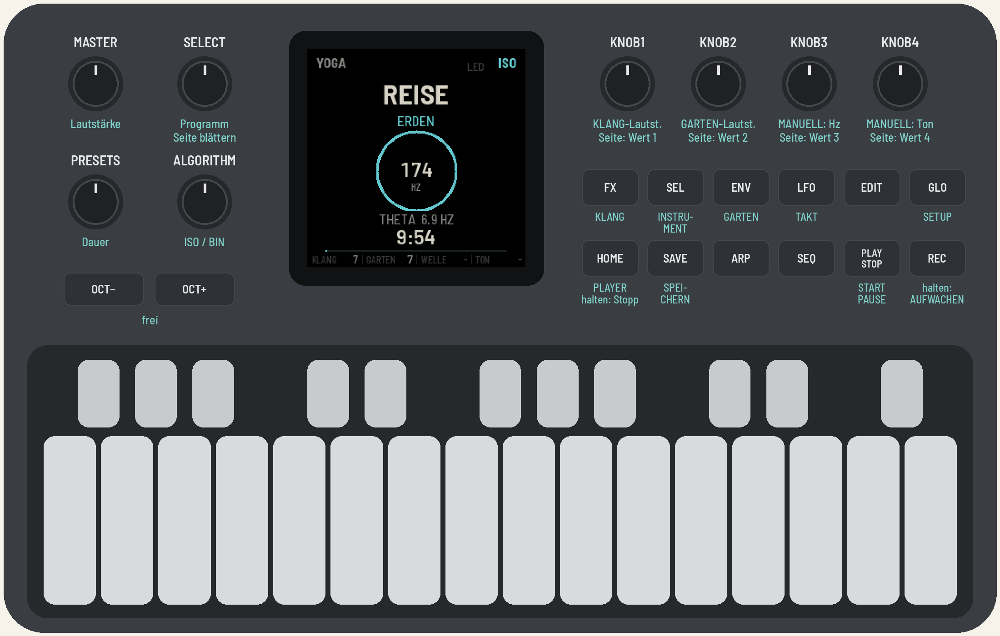

> **English summary:** FM1 YOGA is free firmware for the M-VAVE FM-1 that turns it into a sound companion for the
> final relaxation of a yoga class: guided programs on 174, 396, 432 and 528 Hz with a slow theta-to-delta rhythm
> (isochronic for speakers, binaural for headphones), breathing noise, singing bowls, a generative ambient garden
> (from AMB-1) and a playable handpan, kalimba, tongue drum, bowls or Koshi chimes on the keys. The screen speaks
> German, English or Sanskrit. Built on fm1-base. MPL-2.0.

> [!IMPORTANT]
> - FM1 YOGA erzeugt **Entspannungsklänge**. Es ist kein medizinisches Verfahren und verspricht keine Heilwirkung.
>   Wer zu Anfällen neigt, sollte pulsierende Klänge (ISO) mit Vorsicht nutzen.
> - Eine andere Firmware zu installieren geschieht **auf eigenes Risiko**. Die Original-Firmware von M-VAVE lässt
>   sich jederzeit zurückspielen (siehe [Zurück zur Original-Firmware](#zurück-zur-original-firmware)).
> - FM1 YOGA ist ein unabhängiges Projekt und nicht mit M-VAVE verbunden.

## Inhalt

1. [Was FM1 YOGA kann](#was-fm1-yoga-kann)
2. [Ausprobieren ohne Gerät](#ausprobieren-ohne-gerät)
3. [Installieren](#installieren)
4. [Schnellstart: die erste Endentspannung](#schnellstart-die-erste-endentspannung)
5. [Das Gerät im Überblick](#das-gerät-im-überblick)
6. [Der Bildschirm](#der-bildschirm)
7. [Die Programme](#die-programme)
8. [ISO oder BIN: Lautsprecher oder Kopfhörer](#iso-oder-bin-lautsprecher-oder-kopfhörer)
9. [Die Tastatur: Instrumente und Stummschalten](#die-tastatur-instrumente-und-stummschalten)
10. [Einstellungen](#einstellungen)
11. [Sprache](#sprache)
12. [Häufige Fragen](#häufige-fragen)
13. [Für Entwicklerinnen und Entwickler](#für-entwicklerinnen-und-entwickler)
14. [Lizenz und Dank](#lizenz-und-dank)

---

## Was FM1 YOGA kann

**Zwei Klangschichten, die durch denselben Raum klingen:**

- **KLANG**, die Yoga-Schicht, mit festen Frequenzen:
  - ein **Grundton** (Drone) auf **174 Hz** (erdend), **396 Hz** (loslassen), **432 Hz** (Herz) oder **528 Hz**
    (Wandlung)
  - ein **Gehirnwellen-Rhythmus**: **Theta** (4–7 Hz) zum Ankommen, **Delta** (0,5–3 Hz) in der Tiefe, **Beta**
    (15–18 Hz) nur beim Aufwachen
  - **Atem-Rauschen** wie Meeresbrandung, das im Atemtakt an- und abschwillt
  - **Klangschalen** bei jedem Phasenwechsel und beim Aufwachen, dazu seltene, leise Glöckchen
- **GARTEN**, die musikalische Schicht (aus [AMB-1](https://github.com/charlesvestal/fm1-amb)):
  - vier atmende **Pads**, die langsam wechselnde Akkorde bilden
  - **Glocken** auf Tape-Loops unterschiedlicher Länge
  - ein gleitender **Bass**
  - **Tape-Echo**, ein langer Tape-Loop und ein großer **Plattenhall**

Der Garten ist immer auf den Grundton der Yoga-Schicht gestimmt. Bei HERZ steht er also genau auf 432 Hz.

**Dazu:**

- **6 Programme:** ERDEN, LOSLASSEN, HERZ, WANDLUNG, REISE (alle vier Grundtöne nacheinander) und MANUELL
- **Dauer** 5, 10, 15, 20, 30 Minuten oder **ENDLOS**
- **Kein Durchlauf klingt gleich:** Jeder Start würfelt Phasenlängen, Rhythmen, Klangfarben und den Garten neu.
- **Sanfte Übergänge** ohne Lautstärke-Einbrüche, eine behutsame **Aufwachphase** am Ende
- **Ein Instrument auf den Tasten**, mit Anschlagdynamik und jederzeit spielbar: Handpan, Kalimba,
  Zungentrommel, Klangschalen oder Koshi-Windspiel
- **Stummschalten** jedes Teils mit den kleinen Tasten
- **Sprache:** Deutsch, English oder Sanskrit
- ein **stiller Takt** auf dem Display und/oder der LFO-Taste, als lautloses Metronom
- Viele **Feineinstellungen**, die meisten auf AUTO, und alles dauerhaft speicherbar

---

## Ausprobieren ohne Gerät

Der **Emulator** führt genau dieselbe Firmware im Browser aus, mit Ton, bedienbar mit der Maus oder der
Computertastatur: **https://michamilz.github.io/fm1-yoga/emu/**

Klick auf „Switch on“, damit der Ton startet. Im Emulator gibt es keine Anschlagdynamik.

---

## Installieren

Du brauchst ein **M-VAVE FM-1**, ein **USB-Datenkabel** (ein reines Ladekabel reicht nicht) und einen Computer mit
**Chrome** oder **Edge**.

### Mit dem Web-Installer (empfohlen)

1. Öffne den Installer: **https://michamilz.github.io/fm1-yoga/install/**
2. Verbinde das FM-1 per USB mit dem Computer und schalte es ein.
3. Klicke **Install** und erlaube den MIDI-Zugriff, wenn der Browser fragt.
4. Trenne das Kabel nicht, solange geschrieben wird. Danach startet das FM-1 neu, mit FM1 YOGA.

### Über die Kommandozeile

Lade die Firmware-Datei (z. B. `yoga-1.0.fwsc`) von der
[Releases-Seite](https://github.com/michamilz/fm1-yoga/releases) und hol dir den Quellcode:

```bash
git clone --recursive https://github.com/michamilz/fm1-yoga
```

Installiere Python 3 und die MIDI-Pakete:

```bash
pip3 install mido python-rtmidi
```

Dann im Ordner `fm1-yoga`:

```bash
python3 base/tools/fm1_install.py yoga-1.0.fwsc
```

### Deine Daten beim Wechsel der Firmware

Jede Firmware speichert ihre Daten auf ihre eigene Art im selben Flash-Speicher des FM-1. **Sichere vor dem Wechsel
deine Projekte, Sounds und Samples** mit der Backup-Funktion der Firmware, die gerade läuft.

- FM1 YOGA speichert nur seine Einstellungen. Dafür nutzt es den Speicherbereich, in dem auch andere Firmware auf
  Basis von Felucca bzw. fm1-base (z. B. AMB-1) ihre Einstellungen oder Projekte ablegt. Nach einem Wechsel kann
  dort Gespeichertes einer anderen Firmware verloren sein.
- Umgekehrt liest FM1 YOGA keine Daten anderer Firmware. Findet es keine eigenen Einstellungen, startet es mit
  den Standardwerten.
- Die Projekte und Samples der Original-Firmware von M-VAVE liest FM1 YOGA nicht. Wer zurückwechselt, spielt sie
  aus seinem Backup zurück.

### Zurück zur Original-Firmware

Im Web-Installer gibt es unten **„Back to the stock firmware“**. Lade dort die Datei **FM-1 V15** über den
angegebenen Link herunter, wähle sie aus und drücke den Knopf. M-VAVEs eigenes Update-Programm (M-UPGRADE)
funktioniert ebenfalls.

Wenn das FM-1 zweimal hintereinander nicht richtig startet, startet es im **Safe Mode**. Dann ist kein Ton zu
hören, aber der Web-Installer erreicht das Gerät weiterhin. Ist der Bildschirm ganz schwarz und das Gerät für den
Installer unsichtbar, hilft das Rettungsskript von felucca-bsp. Es läuft auf einem Mac, mit dem normalen USB-Kabel:

```bash
bash -c "$(curl -fsSL https://raw.githubusercontent.com/hugelton/felucca-bsp/main/tools/fm1_rescue.sh)"
```

Das Skript sichert zuerst den Speicher des FM-1, fragt vor dem Schreiben nach und spielt dann die Original-Firmware
von M-VAVE auf.

---

## Schnellstart: die erste Endentspannung

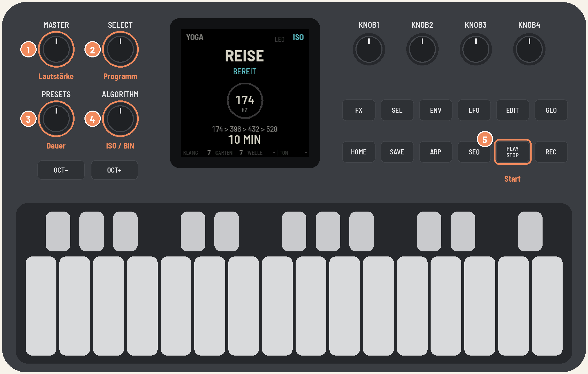

1. **MASTER**: Lautstärke einstellen. Am Anfang lieber leise; das Programm blendet ohnehin sanft ein.
2. **SELECT**: Programm wählen, z. B. **REISE** oder **HERZ**.
3. **PRESETS**: Dauer wählen, z. B. **10 MIN**.
4. **ALGORITHM**: **ISO** für Lautsprecher im Kursraum, **BIN** für Kopfhörer.
5. **PLAY**: Start.

Das Programm blendet über 20–30 Sekunden ein. Danach läuft alles von selbst:

- **PLAY** pausiert und setzt fort (mit 2 Sekunden Ein- und Ausblenden).
- **REC eine Sekunde halten** beginnt sofort das Aufwachen.
- **HOME zwei Sekunden halten** blendet aus und beendet.
- Am Ende erscheint **NAMASTE**. **PLAY** startet einen neuen Durchlauf, **HOME** kehrt in den Ruhezustand zurück.

---

## Das Gerät im Überblick

| Bedienelement | Funktion |
|---|---|
| **MASTER** | Gesamtlautstärke |
| **SELECT** | Programm wählen (im Stillstand); auf den Einstellungsseiten: Unterseiten blättern |
| **PRESETS** | Dauer bzw. Timer (im Stillstand) |
| **ALGORITHM** | ISO oder BIN, jederzeit umschaltbar |
| **K1 / K2** (auf dem Home-Bildschirm) | Lautstärke KLANG / GARTEN |
| **K3 / K4** (auf dem Home-Bildschirm) | im MANUELL-Modus: Wellenfrequenz / Grundton |
| **K1–K4** (auf den Einstellungsseiten) | die vier Werte der Seite |
| **HOME** | zurück zum Player; 2 s halten: Stopp |
| **FX** | Seite **KLANG** (Yoga-Schicht) |
| **ENV** | Seite **GARTEN** |
| **SEL** | Seite **INSTRUMENT** (die Tastatur) |
| **GLO** | Seite **SETUP** (LED-Atem, Dimmen, Sprache, stiller Takt) |
| **PLAY** | Start, Pause, Weiter; nach dem Ende: neuer Durchlauf |
| **REC** | 1 s halten: jetzt aufwachen |
| **SAVE** | Einstellungen dauerhaft speichern; leuchtet, solange etwas geändert ist |
| **Lange Tasten** | das Instrument spielen |
| **Kleine Tasten** | Teile stummschalten |
| **LFO** | leuchtet im Takt, wenn der stille Takt auf LFO oder BEIDE steht |
| OCT−, OCT+, EDIT, ARP, SEQ | frei |

Eine Einstellungsseite schließt du mit derselben Taste wieder oder mit **HOME**. Die Taste der offenen Seite
leuchtet, **PLAY** leuchtet grün, solange ein Programm läuft.

---

## Der Bildschirm

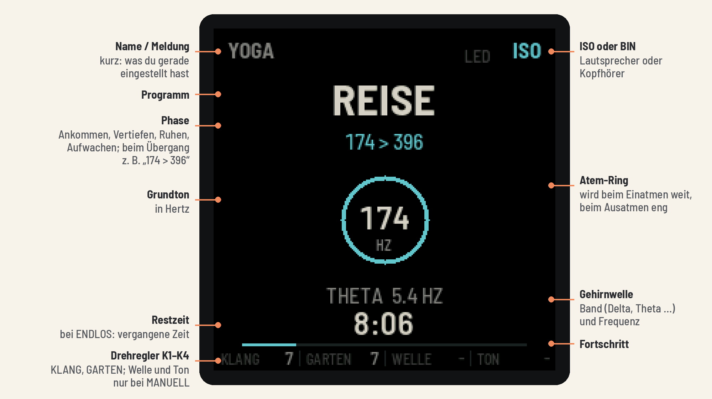

Der **Ring** in der Mitte atmet mit: Er wird beim Einatmen weit und beim Ausatmen eng. Er eignet sich als ruhige
Atemhilfe. Nach 30 Sekunden ohne Bedienung wird die Anzeige gedimmt; das lässt sich unter SETUP ändern.

| | | |
|---|---|---|
| 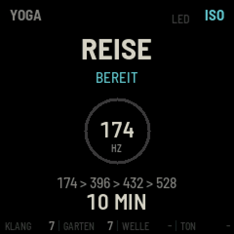 | 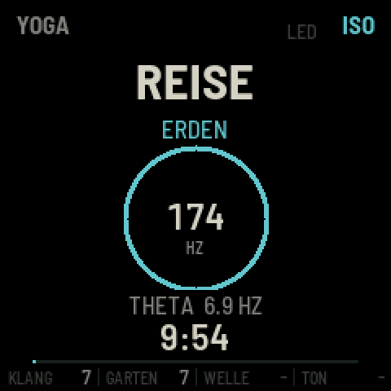 | 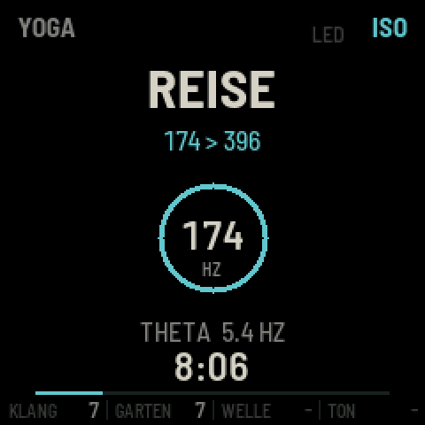 396"> |
| **Bereit**: Programm und Dauer | **Läuft**: Phase, Rhythmus, Restzeit | **Übergang** bei REISE |
| 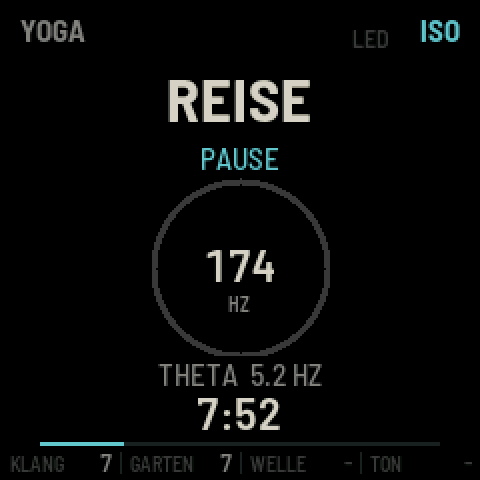 | 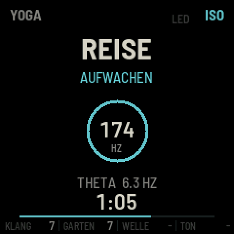 | 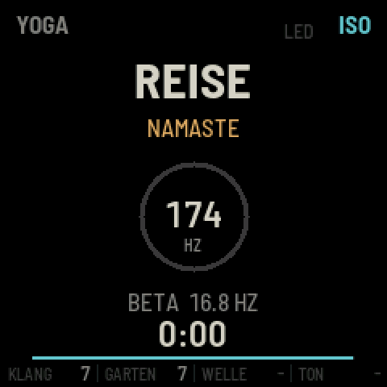 |
| **Pause** | **Aufwachen** | **Ende** |

---

## Die Programme

| Programm | Grundton | Ablauf |
|---|---|---|
| **ERDEN** | 174 Hz | Ankommen (Theta) → Vertiefen → Ruhen (Delta) |
| **LOSLASSEN** | 396 Hz | gleicher Ablauf |
| **HERZ** | 432 Hz | gleicher Ablauf |
| **WANDLUNG** | 528 Hz | gleicher Ablauf |
| **REISE** | 174 → 396 → 432 → 528 Hz | von Theta nach Delta, mit weichen Übergängen |
| **MANUELL** | frei wählbar | Grundton und Wellenfrequenz selbst einstellen |

**So läuft ein Programm ab:**

1. **Einblenden** über 20–30 Sekunden, mit einer Klangschale.
2. **Die Phasen** des Programms. Der Rhythmus sinkt dabei langsam von Theta in Delta.
3. **Aufwachen** über 60–90 Sekunden: Der Rhythmus steigt sanft über Theta und Alpha bis in Beta, der Klang wird
   heller, und es erklingen drei Klangschalen.
4. **Ausblenden** in die Stille, dann **NAMASTE**.

**Übergänge bei REISE:** Zwei Grundtöne blenden über 35–55 Sekunden ineinander, ohne dass die Lautstärke einbricht
oder ein Ton „rutscht“. Während der Überblendung zeigt der Bildschirm z. B. „174 > 396“.

**ENDLOS** (PRESETS ganz nach rechts) gibt es in allen Programmen. Der Ablauf ist der eines 20-Minuten-Programms,
danach bleibt es in der Ruhephase (Delta, bei REISE auf 528 Hz), bis du **REC 1 s hältst**. Statt der Restzeit
zeigt der Bildschirm dann die vergangene Zeit.

### MANUELL

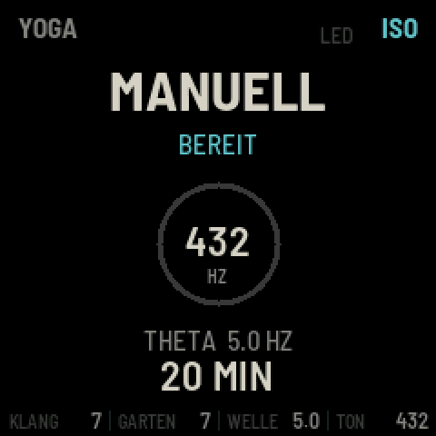

Im manuellen Modus bestimmst du selbst:

- **K3**: Wellenfrequenz 0,5–7,0 Hz (Delta oder Theta)
- **K4**: Grundton 174, 396, 432 oder 528 Hz
- **PRESETS**: Timer 5–60 Minuten oder ENDLOS

Beides lässt sich auch während des Laufens ändern. Ein neuer Grundton blendet in 10 Sekunden weich über, und der
Garten wechselt mit in die neue Tonart. Mit Timer sind die letzten 60–90 Sekunden der eingestellten Zeit die
Aufwachphase.

<br clear="right">

**Kein Durchlauf klingt gleich.** Bei jedem Start werden zufällig variiert:

- die Länge der Phasen (±15 %) und die genauen Wellenfrequenzen innerhalb ihres Bandes
- Obertöne, Schwebung und Atemtempo (sie wandern zusätzlich langsam weiter)
- wann Klangschalen und Glöckchen erklingen
- das Rezept des Gartens: Tonart, Pad-Klang (Rhodes oder Voices), Tempo, Dichte, Hall
- bei REISE manchmal die Reihenfolge von 396 und 432 Hz

---

## ISO oder BIN: Lautsprecher oder Kopfhörer

Beides macht denselben Gehirnwellen-Rhythmus hörbar, zum Beispiel 5 Hz Theta, aber auf verschiedene Weise:

| | **ISO** (isochron) | **BIN** (binaural) |
|---|---|---|
| Wie es funktioniert | Die Lautstärke des Grundtons pulsiert weich im Takt | Links klingt z. B. 432 Hz, rechts 437 Hz; das Gehirn hört den Unterschied von 5 Hz als Schweben |
| Wiedergabe | Lautsprecher oder Kopfhörer | **nur Kopfhörer** |
| Für Gruppen | ja | nein |
| Wirkung | spürbar, direkt | subtil |

**Faustregel:** Im Kurs mit Lautsprecher **ISO**, allein mit Kopfhörern **BIN**. Umschalten geht jederzeit mit
**ALGORITHM**, auch während ein Programm läuft. Oben rechts steht ISO (türkis) oder BIN (sandfarben).

---

## Die Tastatur: Instrumente und Stummschalten

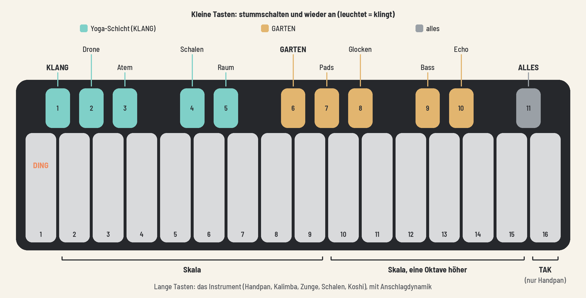

### Lange Tasten: das Instrument

Die 16 langen Tasten spielen ein Instrument, **jederzeit**: im Stillstand, während eines Programms und nach dem Ende.
Je fester du anschlägst, desto lauter und heller klingt es.

- **Taste 1** ist das **Ding**, der tiefe Mittelton.
- **Tasten 2–9** sind die acht Töne der Skala.
- **Tasten 10–15** sind dieselbe Skala eine Oktave höher.
- **Taste 16** ist bei der Handpan das **Tak**, das Klopfen auf den Rand. Bei den anderen Instrumenten spielt sie
  den nächsten Ton der Skala.

| Instrument | Klang |
|---|---|
| **HANDPAN** | warm, schimmernd, mit dem Tak auf Taste 16 |
| **KALIMBA** | gezupfte Metallzungen, kurz und hell, eine Oktave höher |
| **ZUNGE** | Zungentrommel: wie die Handpan, runder und dunkler |
| **SCHALEN** | jede Taste eine Klangschale, weicher Anschlag, langer Nachklang |
| **KOSHI** | Windspiel: Jede Taste lässt 3–6 Klangstäbe nacheinander erklingen, wie ein Windhauch |

Alle Instrumente sind auf den Yoga-Grundton gestimmt, und die Skala passt immer: Es kann nichts „falsch“ klingen.

### Kleine Tasten: stummschalten

Die elf kleinen Tasten schalten Teile **weich stumm und wieder an** (1,5 Sekunden Überblendung).
**Was klingt, leuchtet**; eine stumme Taste ist dunkel.

| Kleine Taste | schaltet stumm |
|---|---|
| **1** | die ganze Yoga-Schicht (KLANG) |
| 2 · 3 · 4 · 5 | Drone · Atem · Schalen · Raum |
| **6** | den ganzen GARTEN |
| 7 · 8 · 9 · 10 | Pads · Glocken · Bass · Echo |
| **11** | alles (das Instrument bleibt spielbar) |

- Die eingestellten Pegel bleiben erhalten. Stumm ist nur ein Schalter.
- Eine Gruppe (Taste 1 oder 6) merkt sich die Zustände ihrer Teile.
- Ein laufendes Programm läuft weiter, auch wenn alles stumm ist. Taste 11 eignet sich zum Beispiel für eine
  Ansage im Kurs.
- Gespeichert wird das nicht: Nach dem Einschalten klingt alles.

---

## Einstellungen

Alle Einstellungsseiten funktionieren gleich:

- **K1–K4** ändern die vier Werte der Seite.
- **SELECT** blättert durch die Unterseiten; die Punkte unten zeigen, wo du bist.
- **SAVE** speichert alles dauerhaft.

Viele Werte stehen anfangs auf **AUTO** (gepunktete Linie). Dann würfelt jeder Start den Wert neu. Drehst du den
Regler, gilt dein fester Wert. Ganz nach links gedreht steht er wieder auf AUTO. Änderungen wirken sofort, auch
während ein Programm läuft.

### KLANG (FX): die Yoga-Schicht

| | |
|---|---|
| 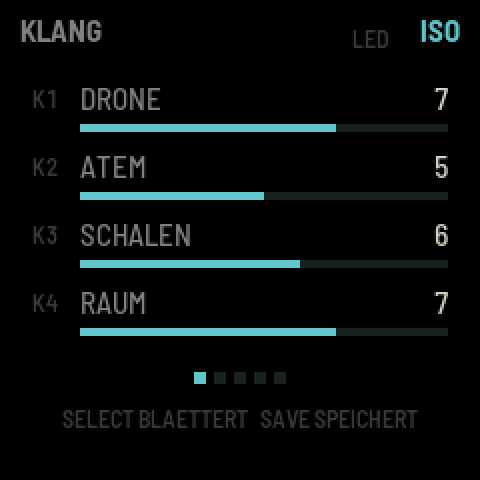 | 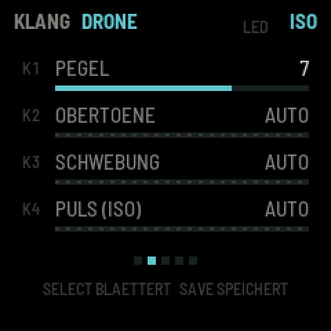 |
| Übersicht: die vier Pegel | Unterseite DRONE |

| Unterseite | K1 | K2 | K3 | K4 |
|---|---|---|---|---|
| Übersicht | Drone | Atem | Schalen | Raum |
| DRONE | Pegel | Obertöne (AUTO, 0–10) | Schwebung (AUTO, 0–10) | Puls-Tiefe bei ISO (AUTO, 0–10) |
| ATEM | Pegel | Tempo (AUTO, 3–8 Züge/Min.) | Farbe der Brandung (dunkel – hell) | Welle: wie stark die Drone mitatmet |
| SCHALEN | Pegel | Glöckchen (AUTO, 0 = aus – 10 = oft) | Tonlage (tief, mittel, hoch) | Nachklang (kurz – lang) |
| RAUM | Hall-Anteil | Hallgröße (AUTO, 0–10) | Echo-Anteil | – |

### GARTEN (ENV): die musikalische Schicht

| | |
|---|---|
| 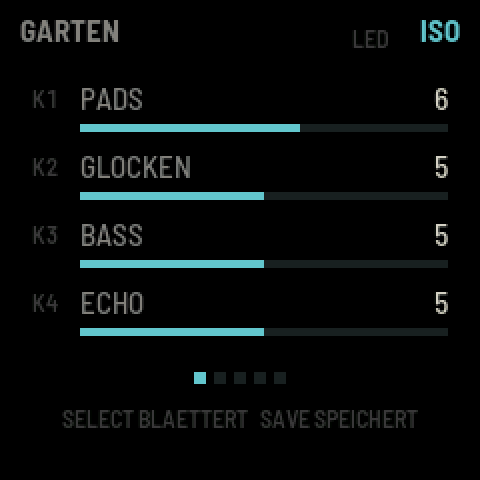 | 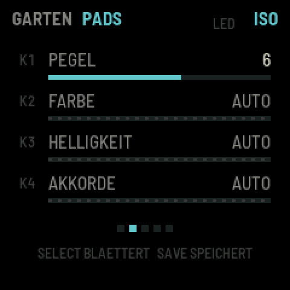 |
| Übersicht: die vier Pegel | Unterseite PADS |

| Unterseite | K1 | K2 | K3 | K4 |
|---|---|---|---|---|
| Übersicht | Pads | Glocken | Bass | Echo |
| PADS | Pegel | Farbe (AUTO, Rhodes, Voices) | Helligkeit (AUTO, 0–10) | Akkordwechsel (AUTO, 0 = selten – 10 = oft) |
| GLOCKEN | Pegel | Dichte (AUTO, 0–10) | Klang (AUTO, weich – hell) | Oktave (AUTO, −2 bis +2) |
| BASS | Pegel | Oktave (AUTO, −1 bis +1) | Gleiten (AUTO, 0–10) | Quinte (AUTO, 0–10) |
| ECHO | Pegel | Echozeit (AUTO, 1/4. bis 4 Takte) | Hall des Gartens (AUTO, 0–10) | Bewegung (AUTO, 0–10) |

### INSTRUMENT (SEL): die Tastatur

| | | |
|---|---|---|
| 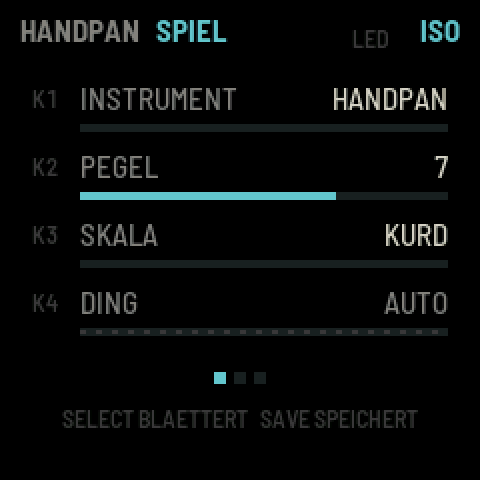 | 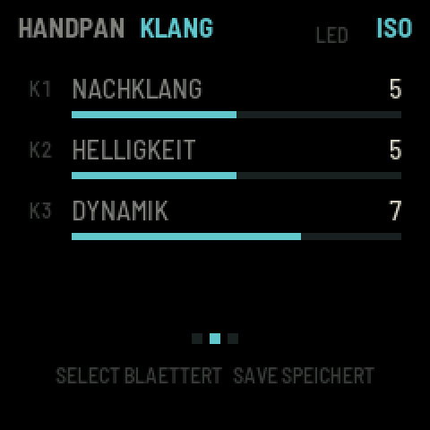 | 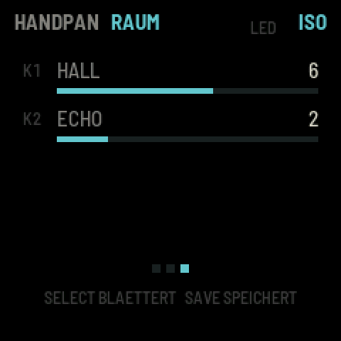 |
| SPIEL | KLANG | RAUM |

| Unterseite | K1 | K2 | K3 | K4 |
|---|---|---|---|---|
| SPIEL | Instrument | Pegel | Skala | Ding (AUTO = folgt dem Grundton, oder fest 174/396/432/528) |
| KLANG | Nachklang | Helligkeit | Dynamik (0 = jeder Anschlag gleich) | – |
| RAUM | Hall | Echo | – | – |

**Skalen:** KURD (Moll, der Klassiker), CELTIC (Moll), INTEGRAL, PYGMY, HIJAZ (orientalisch), SABYE (Dur, hell),
AKEBONO (japanisch, sehr ruhig). Mit Ding auf AUTO liegt das Ding auf 174, 198, 216 oder 264 Hz, je nach
Grundton.

### SETUP (GLO)

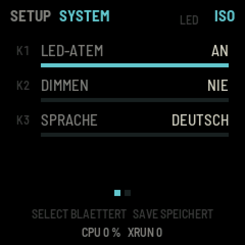

Zwei Unterseiten, SELECT blättert:

| SYSTEM | |
|---|---|
| **K1 LED-Atem** | An: Ein gedämpftes Licht wandert beim Einatmen über die langen Tasten nach rechts und beim Ausatmen zurück |
| **K2 Dimmen** | Das Display dimmt nach 30 s oder 2 min ohne Bedienung, oder nie |
| **K3 Sprache** | Deutsch, English, Sanskrit |

| TAKT | |
|---|---|
| **K1 Tempo** | ein stiller, fester Takt für dich als Lehrkraft: AUS oder 20–120 pro Minute |
| **K2 Anzeige** | DISPLAY (ein Punkt oben im Display leuchtet zu jedem Schlag auf), LFO (die Taste LFO leuchtet) oder BEIDE |

<br clear="right">

Der Takt ist nicht zu hören und hängt weder am Atem noch am Programm. Er läuft auch im Stillstand, etwa zum Zählen
von Atemzügen oder Sekunden in einer Haltung.

### Speichern

**SAVE** speichert alle Einstellungen dauerhaft: Programm, Dauer, ISO/BIN, alle Pegel und Feineinstellungen,
Instrument, SETUP, Sprache und der stille Takt. SAVE leuchtet, solange es ungespeicherte Änderungen gibt. Nicht gespeichert werden
die Stumm-Zustände der kleinen Tasten.

---

## Sprache

Unter **GLO → K3** stellst du die Sprache der Anzeige ein: **Deutsch** (Standard), **English** oder **Sanskrit**.
**SAVE** speichert die Wahl dauerhaft.

Sanskrit steht in lateinischer Umschrift ohne Akzente, weil das Display nur lateinische Schrift kennt. Yogische
Begriffe sind auf Sanskrit, technische Begriffe wie Hall, Echo oder Pegel auf Englisch:

| Deutsch | English | Sanskrit | Bedeutung |
|---|---|---|---|
| ERDEN | EARTH | PRITHVI | Erde |
| LOSLASSEN | RELEASE | VAIRAGYA | Loslösung |
| HERZ | HEART | ANAHATA | Herz-Chakra |
| WANDLUNG | TRANSFORM | PARINAMA | Wandlung |
| REISE | JOURNEY | YATRA | Reise |
| MANUELL | MANUAL | SVATANTRA | selbstbestimmt |
| BEREIT · PAUSE | READY · PAUSE | SAJJA · VIRAMA | bereit · Innehalten |
| ANKOMMEN · VERTIEFEN · RUHEN · AUFWACHEN | ARRIVE · DEEPEN · REST · AWAKEN | AGAMANA · DHYANA · VISHRAMA · PRABODHA | Ankunft · Meditation · Ruhe · Erwachen |
| KLANG · GARTEN | SOUND · GARDEN | NADA · UDYANA | Klang · Garten |
| DRONE · ATEM · SCHALEN · RAUM | DRONE · BREATH · BOWLS · SPACE | SHRUTI · PRANA · PATRA · AKASHA | Bordunton · Atem · Schale · Raum/Äther |
| GLOCKEN · ECHO · ALLES | BELLS · ECHO · ALL | GHANTA · PRATIDHVANI · SARVA | Glocke · Widerhall · alles |
| STUMM · ENDLOS | MUTE · ENDLESS | MAUNA · ANANTA | Schweigen · unendlich |

---

## Häufige Fragen

**Ich höre nichts.**
Steht MASTER weit genug auf? Ist eine kleine Taste dunkel, also stumm? Die Taste ganz rechts (11) schaltet alles.
Die Lautstärken von KLANG und GARTEN siehst du unten auf dem Home-Bildschirm (K1, K2).

**Bei BIN höre ich kein Schweben.**
Binaurale Beats wirken nur mit Kopfhörern, weil jedes Ohr einen eigenen Ton bekommen muss. Über Lautsprecher
nimm **ISO**.

**Es klingt bei jedem Start anders. Ist das richtig?**
Ja, mit Absicht. Wer etwas fest haben möchte, stellt den jeweiligen Wert von AUTO auf eine Zahl und speichert mit
SAVE.

**Die Tasten spielen keinen Ton.**
Prüfe auf der Seite INSTRUMENT (SEL) den Pegel. Die kleinen Tasten spielen keine Töne, sie schalten stumm.

**Meine Einstellungen sind nach dem Ausschalten weg.**
Vor dem Ausschalten **SAVE** drücken. SAVE leuchtet, solange etwas noch nicht gespeichert ist.

**Das Display ist so dunkel.**
Es dimmt nach 30 Sekunden ohne Bedienung. Jeder Tastendruck macht es wieder hell. Unter SETUP → K2 lässt sich das
abschalten.

**Kann ich Musik vom Computer über das FM-1 abspielen?**
Ja. Per USB erscheint das FM-1 als Audiogerät; die Musik wird zur Firmware dazugemischt und mit MASTER geregelt.
Ebenso lässt sich der Klang des FM-1 per USB aufnehmen.

---

## Für Entwicklerinnen und Entwickler

### Aufbau

| Pfad | Inhalt |
|---|---|
| `app/dsp/yoga_dsp.c` | die Yoga-Schicht und die Instrumente (float, ohne libm, ohne 64-Bit-Multiplikationen) |
| `app/dsp/amb.c`, `amb.h` | die Engine von AMB-1 (MPL-2.0); Änderungen sind mit „yoga:“ markiert |
| `app/yoga_program.c` | Programme, Zeitablauf, Übergänge, Zufall, Stummschalten, Instrumente |
| `app/ui.c`, `app/lang.c` | Bildschirm, Bedienung, LEDs; die drei Sprachen |
| `app/app.c`, `app.h`, `fm1.toml` | die Anbindung an fm1-base und die gespeicherten Einstellungen |
| `base/` | [fm1-base](https://github.com/charlesvestal/fm1-base) mit felucca-bsp (Git-Submodul) |
| `tests/` | Klangtests (`yoga_test.c`) und Skripte für den Host-Simulator |
| `tools/` | Bilder für diese README, Veröffentlichen, der Emulator-Server, die Podman-Weiche |
| `docs/img/` | die Bilder dieser README (erzeugt von `tools/gen_docs_figures.py`) |
| `fmhub.json`, `.github/workflows/release.yml` | die Karte auf The Firmware Hub; signierte Releases aus dem Quellcode |

### Voraussetzungen (macOS)

- **Podman** (oder Docker). Die Toolchain läuft in einem linux/amd64-Container. `build.sh` leitet die
  Docker-Aufrufe von fm1-base über `tools/podman-bin/docker` an Podman weiter. Die Podman-VM muss laufen
  (`podman machine start`).
- die **JieLi-Linux-Toolchain** in `~/.jieli/toolchain`: `base/tools/get_toolchain.sh`
- drei Dateien des **JieLi AC79 SDK** (Apache-2.0) in `~/fw-AC79_AIoT_SDK`. Ein Sparse-Checkout reicht:

  ```bash
  git clone --depth 1 --filter=blob:none --sparse --branch AC79NN_SDK_V1.2.1_2023-12-13 https://gitee.com/Jieli-Tech/fw-AC79_AIoT_SDK.git ~/fw-AC79_AIoT_SDK
  ```

  ```bash
  git -C ~/fw-AC79_AIoT_SDK sparse-checkout set --no-cone /cpu/wl82/tools/uboot.boot /cpu/wl82/tools/cfg_tool.bin /cpu/wl82/tools/cfg/eq_cfg_hw.bin
  ```

- **Python 3** mit Pillow: `pip3 install Pillow`
- für den Browser-Emulator **Emscripten** (z. B. über [emsdk](https://github.com/emscripten-core/emsdk))

### Bauen und testen

Firmware bauen (Ergebnis: `app/build/yoga.fwsc`):

```bash
./build.sh
```

Alle Tests: Klang, Programme, Übergänge, Instrumente sowie die ganze App im Host-Simulator, mit Screenshots und
Audio in `app/build/scenarios/`:

```bash
tests/run_tests.sh
```

Ein Programm als WAV zum Probehören (Programm, Minuten, iso oder bin, optional ein Seed):

```bash
build/yoga_test wav build/reise.wav reise 10 iso
```

Browser-Emulator bauen:

```bash
source ~/emsdk/emsdk_env.sh && ./build.sh --web
```

Den Emulator starten (`http://localhost:8792`):

```bash
python3 tools/serve-emu.py
```

Die Bilder dieser README neu erzeugen (aus dem Host-Simulator, nach `./build.sh --host`):

```bash
python3 tools/gen_docs_figures.py
```

### Veröffentlichen

1. **Release:** Ein Versions-Tag genügt. GitHub baut die Firmware dann aus dem Quellcode, mit dem geteilten Workflow
   der [Firmware Hub](https://thefirmwarehub.com) (`.github/workflows/release.yml`), führt die Tests aus, signiert
   das Paket („Built from source on GitHub“) und hängt `yoga-1.0.fwsc` an das Release:

   ```bash
   git tag v1.0 && git push origin v1.0
   ```

2. **Website** mit Web-Installer, Emulator und Download auf GitHub Pages (Branch `gh-pages`). In den
   Repository-Einstellungen unter **Pages** muss dafür als Quelle der Branch `gh-pages` gewählt sein:

   ```bash
   tools/publish.sh 1.0
   ```

3. **The Firmware Hub:** Die Beschreibung für die Karte steht in `fmhub.json`, das Bild in `docs/img/hub-240.png`.
   Die Identität eines Release ist `FM-1_432` gefolgt von der Version (1.0: `FM-1_432010000`). Über USB meldet sich
   das Gerät als MIDI-Gerät „YOGA FM-1“.

---

## Lizenz und Dank

FM1 YOGA ist freie Software unter der **Mozilla Public License 2.0** (`LICENSE`).

- Die Klang-Engine des Gartens (Pads, Glocken-Loops, Bass, Tape-Echo, Plattenhall) stammt aus
  [AMB-1](https://github.com/charlesvestal/fm1-amb) von **Charles Vestal** (MPL-2.0). Der Plattenhall folgt
  Jon Dattorro, „Effect Design, Part 1“ (JAES 1997).
- Die Plattform [fm1-base](https://github.com/charlesvestal/fm1-base) von Charles Vestal und
  [felucca-bsp](https://github.com/hugelton/felucca-bsp) gehen auf [Felucca](https://github.com/hugelton/Felucca)
  von **Leo Kuroshita** (Hügelton Instruments) zurück (MPL-2.0).
- Schriften: Barlow (The Barlow Project Authors) und Terminus (Dimitar Toshkov Zhekov), SIL OFL 1.1
  (`base/assets/fonts/`).
- Drei Dateien des JieLi AC79 SDK (Apache-2.0) werden beim Bauen aus dem SDK gelesen und ins Paket gelegt; sie sind
  nicht Teil dieses Repositorys.

„M-VAVE“ und „FM-1“ sind Marken ihrer Inhaber und werden hier nur genannt, um zu sagen, auf welchem Gerät FM1 YOGA
läuft. FM1 YOGA ist nicht mit M-VAVE, Hügelton Instruments oder den Autoren von AMB-1 verbunden und wird von ihnen
weder unterstützt noch geprüft.
