# FM1 YOGA

**English** · [Deutsch](README-de.md)

**Sounds for Shavasana and meditation – a firmware for the M-VAVE FM-1**

FM1 YOGA turns the small FM-1 synthesizer into a calm sound companion for Shavasana at the end of a yoga class, and
for meditation. Choose a program, press PLAY, and the device guides the relaxation: a sustained carrier tone, gentle
rhythms, breathing noise, singing bowls and a floating ambient garden. At the end it wakes you gently. On the keys you
can play a handpan, kalimba, singing bowls or wind chimes along with it.

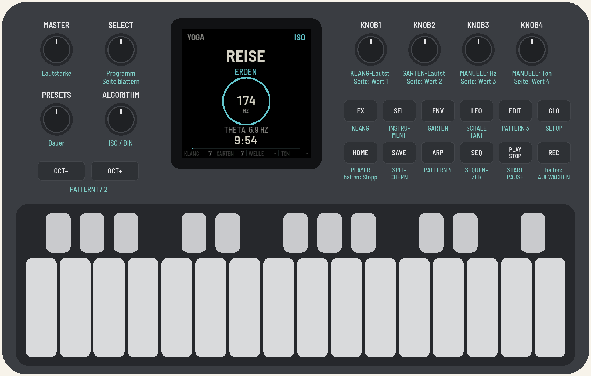

> [!IMPORTANT]
> - FM1 YOGA makes **relaxation sounds**. It is not a medical treatment and promises no healing effect. If you are
>   prone to seizures, use pulsing sounds (ISO) with care.
> - Installing another firmware is **at your own risk**. M-VAVE's stock firmware can be put back at any time (see
>   [Back to the stock firmware](#back-to-the-stock-firmware)).
> - FM1 YOGA is an independent project and is not affiliated with M-VAVE.

The pictures in this README show the screen in German, the device's default language. Switch it to English under
**GLO → K3** (see [Language](#language)); the words on the screen then match the ones used here.

## Contents

1. [What FM1 YOGA does](#what-fm1-yoga-does)
2. [Try it without a device](#try-it-without-a-device)
3. [Install](#install)
4. [Quick start: your first Shavasana](#quick-start-your-first-Shavasana)
5. [For meditation](#for-meditation)
6. [The device at a glance](#the-device-at-a-glance)
7. [The screen](#the-screen)
8. [The programs](#the-programs)
9. [ISO or BIN: speakers or headphones](#iso-or-bin-speakers-or-headphones)
10. [The keys: instruments and muting](#the-keys-instruments-and-muting)
11. [The sequencer: your own patterns](#the-sequencer-your-own-patterns)
12. [Settings](#settings)
13. [Language](#language)
14. [FAQ](#faq)
15. [For developers](#for-developers)
16. [Licence and thanks](#licence-and-thanks)

---

## What FM1 YOGA does

**Two layers of sound, sounding through the same space:**

- **SOUND**, the yoga layer, on fixed frequencies:
  - a **carrier** (drone) on **174 Hz** (grounding), **396 Hz** (letting go), **432 Hz** (heart) or **528 Hz**
    (transformation)
  - a **brainwave rhythm**: **theta** (4–7 Hz) for arriving, **delta** (0.5–3 Hz) in the depth, **beta**
    (15–18 Hz) only when waking up
  - **breathing noise** like surf, swelling and fading with the breath
  - **singing bowls** at every change of phase and when waking up, with rare, quiet chimes
- **GARDEN**, the musical layer (from [AMB-1](https://github.com/charlesvestal/fm1-amb)):
  - four breathing **pads** forming slowly changing chords
  - **bells** on tape loops of different lengths, or played by one of the keys' instruments
  - a gliding **bass**
  - **tape echo**, a long tape loop and a large **plate reverb**

The garden is always tuned to the yoga layer's carrier. With HEART it sits exactly on 432 Hz.

**And:**

- **6 programs:** EARTH, RELEASE, HEART, TRANSFORM, JOURNEY (all four carriers in turn) and MANUAL
- **Duration** 5, 10, 15, 20, 30 minutes or **ENDLESS**
- **For meditation too:** a calm timer with a gentle end, a fixed rhythm in MANUAL, or ENDLESS
- **No two runs sound alike:** every start draws new phase lengths, rhythms, timbres and a new garden.
- **Smooth transitions** without dips in loudness, a gentle **wake-up** at the end
- **An instrument on the keys**, velocity-sensitive and playable at any time: handpan, kalimba, tongue drum,
  singing bowls or Koshi wind chimes
- **Muting** of every part with the small keys
- **Sequencer:** record four patterns of your own, live, in any program
- **Language:** Deutsch, English or Sanskrit
- a **silent beat** on the screen and/or the LFO button, as a soundless metronome
- many **fine settings**, most of them on AUTO, and everything can be saved

---

## Try it without a device

The **emulator** runs exactly the same firmware in the browser, with sound, played with the mouse or the computer
keyboard: **https://michamilz.github.io/fm1-yoga/emu/**

Click "Switch on" to start the sound. The emulator has no velocity.

---

## Install

You need an **M-VAVE FM-1**, a **USB data cable** (a charging-only cable won't do) and a computer with **Chrome** or
**Edge**.

FM1 YOGA runs on both known versions of the FM-1: with the original flash memory (Puya P25Q80) and with the
UC25HQ80 that units have carried since autumn 2026. On these newer units, versions up to 1.0-rc2 save nothing (SAVE
fails) and cannot install an update from themselves. Bring such a unit back to the stock firmware with the rescue
script (see [Back to the stock firmware](#back-to-the-stock-firmware)) and install FM1 YOGA again from there.

### With the web installer (recommended)

1. Open the installer: **https://michamilz.github.io/fm1-yoga/install/**
2. Connect the FM-1 to the computer by USB and switch it on.
3. Click **Install** and allow MIDI access when the browser asks.
4. Do not unplug the cable while it writes. The FM-1 then restarts with FM1 YOGA.

### From the command line

Download the firmware file (e.g. `yoga-1.0.fwsc`) from the
[releases page](https://github.com/michamilz/fm1-yoga/releases) and get the source:

```bash
git clone --recursive https://github.com/michamilz/fm1-yoga
```

Install Python 3 and the MIDI packages:

```bash
pip3 install mido python-rtmidi
```

Then, in the `fm1-yoga` folder:

```bash
python3 base/tools/fm1_install.py yoga-1.0.fwsc
```

### Your data when switching firmware

Every firmware keeps its data in its own way in the same flash memory of the FM-1. **Before switching, back up your
projects, sounds and samples** with the backup function of the firmware that is running.

- FM1 YOGA saves only its settings. It uses the storage area where other firmwares based on Felucca or fm1-base
  (AMB-1, for example) keep their settings or projects. After a switch, what another firmware saved there may be
  lost.
- In turn, FM1 YOGA reads no other firmware's data. If it finds no settings of its own, it starts with its defaults.
- FM1 YOGA does not read the projects and samples of M-VAVE's stock firmware. If you switch back, restore them from
  your backup.

### Back to the stock firmware

At the bottom of the web installer is **"Back to the stock firmware"**. Download the **FM-1 V15** file from the link
given there, select it and press the button. M-VAVE's own update program (M-UPGRADE) works as well.

If the FM-1 fails to start properly twice in a row, it starts in **safe mode**. There is no sound then, but the web
installer still reaches the device. If the screen stays black and the installer cannot see the device, felucca-bsp's
rescue script helps. It runs on a Mac, with the normal USB cable:

```bash
bash -c "$(curl -fsSL https://raw.githubusercontent.com/hugelton/felucca-bsp/main/tools/fm1_rescue.sh)"
```

The script first backs up the FM-1's memory, asks before it writes, and then puts M-VAVE's stock firmware back.

---

## Quick start: your first Shavasana

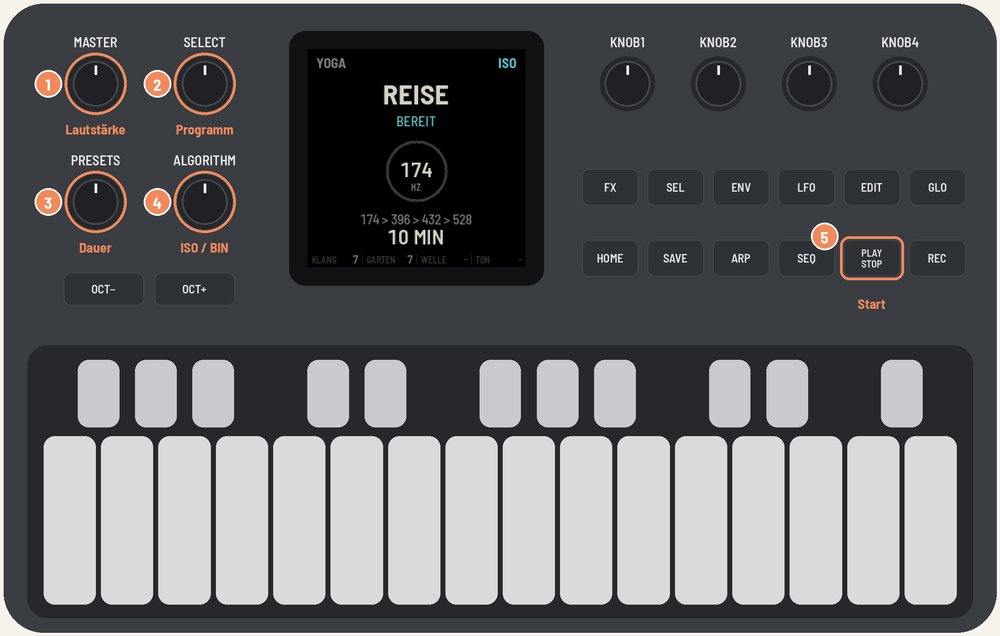

1. **MASTER**: set the volume. Start quiet; the program fades in gently anyway.
2. **SELECT**: choose a program, e.g. **JOURNEY** or **HEART**.
3. **PRESETS**: choose the duration, e.g. **10 MIN**.
4. **ALGORITHM**: **ISO** for speakers in the class room, **BIN** for headphones.
5. **PLAY**: start.

The program fades in over 20–30 seconds. After that, everything runs by itself:

- **PLAY** pauses and resumes (with a 2-second fade out and in).
- **Holding REC for a second** begins the wake-up at once.
- **Holding HOME for two seconds** fades out and stops.
- At the end, **NAMASTE** appears. **PLAY** starts a new run, **SELECT** chooses the next program and makes it ready
  to start, **HOME** returns to rest.

---

## For meditation

FM1 YOGA accompanies meditation too, alone or in a group.

- **As a timer:** choose the duration with PRESETS, 5 to 30 minutes or ENDLESS. At the end, the wake-up brings you
  back gently with three singing bowls, like the bell at the end of a sitting.
- **A fixed rhythm:** in **MANUAL**, K3 sets the brainwave rate, theta (4–7 Hz) for an awake, deep meditation or delta
  for deep rest, and K4 the carrier.
- **Alone with headphones, BIN**; in a group over speakers, ISO.
- **Breath:** the ring on the screen and the LED breath on the keys set a calm breathing pace. Set the pace under
  SOUND → BREATH (3–8 breaths a minute).
- **Counting without sound:** the silent beat (GLO → BEAT) lights at a steady tempo, for counting breaths, say.
- **Less is more:** small key 6 mutes the GARDEN. The carrier, the breath and the bowls remain.

---

## The device at a glance

| Control | What it does |
|---|---|
| **MASTER** | overall volume |
| **SELECT** | choose the program (at rest and after the end); on the settings pages: turn through the sub-pages |
| **PRESETS** | duration or timer (at rest) |
| **ALGORITHM** | ISO or BIN, at any time |
| **K1 / K2** (on the home screen) | volume of SOUND / GARDEN |
| **K3 / K4** (on the home screen) | in MANUAL: brainwave rate / carrier |
| **K1–K4** (on the settings pages) | the page's four values |
| **HOME** | back to the player; hold 2 s: stop |
| **FX** | the **SOUND** page (the yoga layer) |
| **ENV** | the **GARDEN** page |
| **SEL** | the **INSTRUMENT** page (the keys) |
| **GLO** | the **SETUP** page (LED breath, dimming, language, silent beat) |
| **PLAY** | start, pause, resume; after the end: a new run |
| **REC** | hold 1 s: wake up now; on the SEQUENCER page: recording on/off |
| **SAVE** | save the settings; lit while something has changed |
| **Long keys** | play the instrument |
| **Small keys** | mute parts |
| **LFO** | strikes a singing bowl while a program runs; lights with the beat when the silent beat shows on LFO or BOTH |
| **SEQ** | the **SEQUENCER** page |
| **OCT−, OCT+, EDIT, ARP** | patterns 1, 2, 3, 4 |

Close a settings page with the same button or with **HOME**. The open page's button is lit; **PLAY** is lit green
while a program runs.

---

## The screen

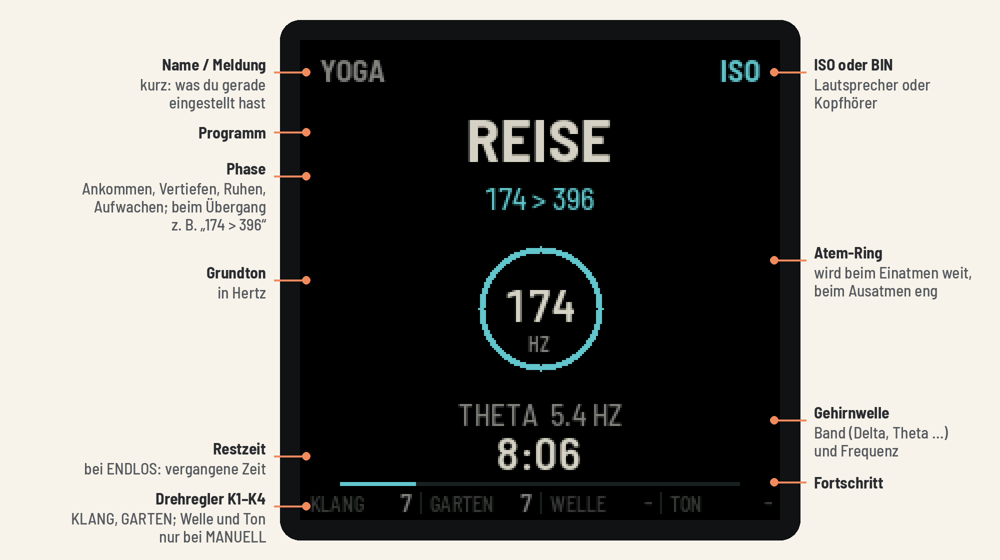

The **ring** in the middle breathes along: it widens as you breathe in and narrows as you breathe out. It makes a
calm breathing guide. After 30 seconds without input the screen dims; you can change that under SETUP.

| | | |
|---|---|---|
| 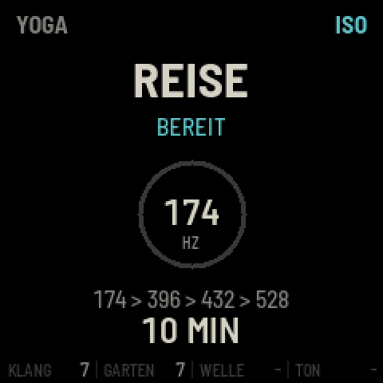 | 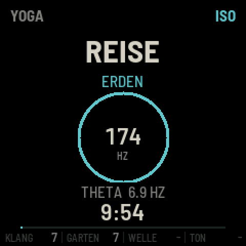 | 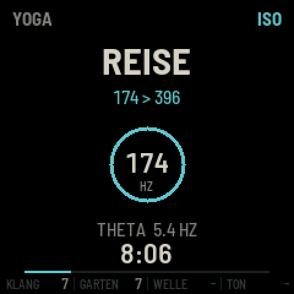 396"> |
| **Ready**: program and duration | **Running**: phase, rhythm, time left | **Transition** in JOURNEY |
| 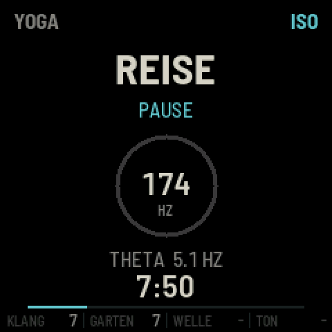 | 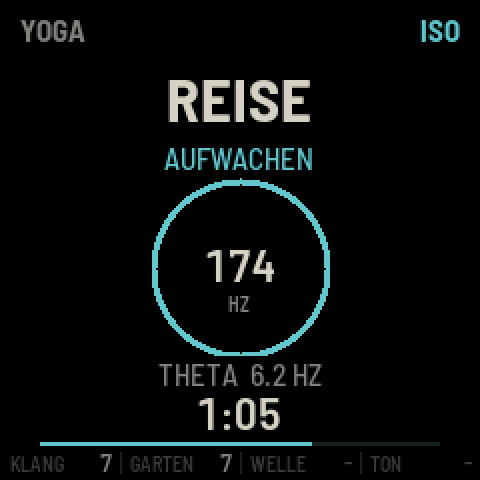 | 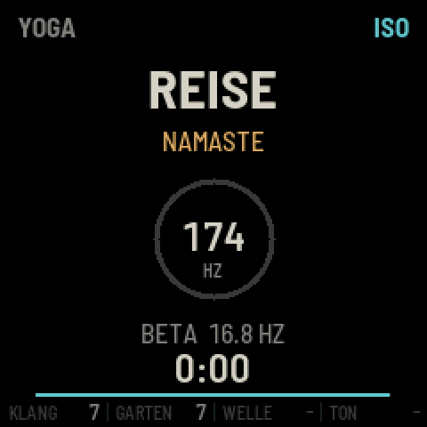 |
| **Pause** | **Awaken** | **End** |

---

## The programs

| Program | Carrier | Course |
|---|---|---|
| **EARTH** | 174 Hz | arrive (theta) → deepen → rest (delta) |
| **RELEASE** | 396 Hz | the same course |
| **HEART** | 432 Hz | the same course |
| **TRANSFORM** | 528 Hz | the same course |
| **JOURNEY** | 174 → 396 → 432 → 528 Hz | from theta to delta, with smooth transitions |
| **MANUAL** | your choice | set the carrier and the brainwave rate yourself |

**How a program runs:**

1. **Fade-in** over 20–30 seconds, with a singing bowl.
2. **The program's phases.** The rhythm sinks slowly from theta into delta.
3. **Wake-up** over 60–90 seconds: the rhythm rises gently through theta and alpha into beta, the sound brightens,
   and three singing bowls sound.
4. **Fade-out** into silence, then **NAMASTE**.

**Transitions in JOURNEY:** two carriers crossfade over 35–55 seconds, without a dip in loudness and without a tone
sliding. During the crossfade the screen shows, for example, "174 > 396".

**The change announces itself,** so you can leave room in time while playing:

| When | Long keys | Screen |
|---|---|---|
| 30 seconds before | pulse calmly, dimmed | "CHANGE IN 30" counts down, the ring turns sand-coloured |
| during the transition | stay dimmed: better not play | "174 > 396", the ring stays sand-coloured |
| after it | the LED breath again | the ring turquoise again |

The announcement always appears, even with the LED breath off. A new carrier in MANUAL changes at once, so there is
only the second stage.

**ENDLESS** (PRESETS all the way right) works in every program. The course is that of a 20-minute program; after it,
the program stays in the resting phase (delta, on 528 Hz in JOURNEY) until you **hold REC for 1 s**. The screen then
shows the time passed instead of the time left.

### MANUAL

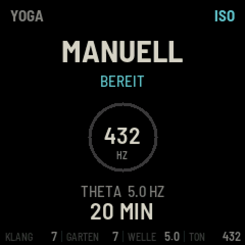

In manual mode you decide:

- **K3**: brainwave rate 0.5–7.0 Hz (delta or theta)
- **K4**: carrier 174, 396, 432 or 528 Hz
- **PRESETS**: timer 5–60 minutes or ENDLESS

Both can be changed while it runs. A new carrier crossfades smoothly in 10 seconds, and the garden moves into the
new key with it. With a timer, the last 60–90 seconds of the set time are the wake-up.

<br clear="right">

**No two runs sound alike.** Each start varies at random:

- the length of the phases (±15 %) and the exact brainwave rates within their band
- overtones, beating and breathing pace (they also drift slowly on)
- when singing bowls and chimes sound
- the garden's recipe: key, pad sound (Rhodes or Voices), tempo, density, reverb
- in JOURNEY, sometimes the order of 396 and 432 Hz

---

## ISO or BIN: speakers or headphones

Both make the same brainwave rhythm audible, 5 Hz theta for example, but in different ways:

| | **ISO** (isochronic) | **BIN** (binaural) |
|---|---|---|
| How it works | the carrier's loudness pulses softly with the rhythm | e.g. 432 Hz on the left, 437 Hz on the right; the brain hears the 5 Hz difference as a beating |
| Playback | speakers or headphones | **headphones only** |
| For groups | yes | no |
| Effect | noticeable, direct | subtle |

**Rule of thumb:** in a class with speakers **ISO**, alone with headphones **BIN**. Switch at any time with
**ALGORITHM**, even while a program runs. Top right shows ISO (turquoise) or BIN (sand).

---

## The keys: instruments and muting

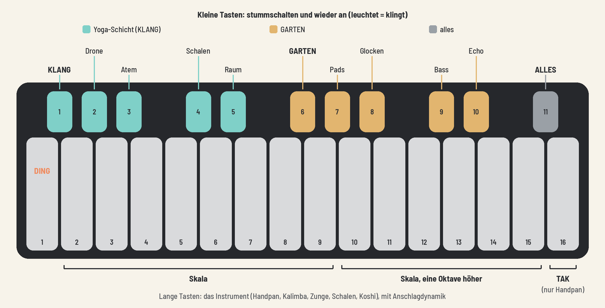

### Long keys: the instrument

The 16 long keys play an instrument **at any time**: at rest, during a program and after the end. The harder you
strike, the louder and brighter it sounds.

- **Key 1** is the **ding**, the deep centre note.
- **Keys 2–9** are the scale's eight notes.
- **Keys 10–15** are the same scale an octave up.
- **Key 16** is the handpan's **tak**, the knock on the rim. On the other instruments it plays the scale's next
  note.

| Instrument | Sound |
|---|---|
| **HANDPAN** | warm, shimmering, with the tak on key 16 |
| **KALIMBA** | plucked metal tines, short and bright, an octave up |
| **TONGUE** | tongue drum: like the handpan, rounder and darker |
| **BOWLS** | a singing bowl on every key, a soft strike, a long ring |
| **KOSHI** | wind chimes: every key lets 3–6 rods ring one after another, like a breeze |

All instruments are tuned to the yoga carrier, and the scale always fits: nothing can sound "wrong".

Up to eight notes ring at once. If another comes, the quietest fades out softly. If computing time runs short, the
firmware takes voices away for a while (at least four stay) rather than crackle.

### Small keys: muting

The eleven small keys **mute parts softly and bring them back** (a 1.5-second crossfade). **What sounds is lit**; a
muted key is dark.

| Small key | mutes |
|---|---|
| **1** | the whole yoga layer (SOUND) |
| 2 · 3 · 4 · 5 | drone · breath · bowls · space |
| **6** | the whole GARDEN |
| 7 · 8 · 9 · 10 | pads · bells · bass · echo |
| **11** | everything (the instrument stays playable) |

- The levels you set are kept. Mute is only a switch.
- A group (key 1 or 6) remembers the states of its parts.
- A running program keeps running even when everything is muted. Key 11 is handy for an announcement in class, for
  example.
- It is not saved: after switching on, everything sounds.

---

## The sequencer: your own patterns

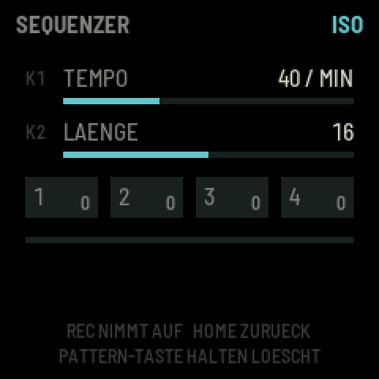

You can record four patterns of your own. They run in **every program** and repeat until you choose another. A
pattern remembers **what** you played: keys, singing bowls and muting. The pitch comes from the program that is
running. In JOURNEY a pattern therefore follows the carrier, and you can change the instrument and the scale
afterwards too.

**Patterns 1–4** are on **OCT−, OCT+, EDIT and ARP**. When a pattern plays a note, the long key it plays lights up
briefly.

<br clear="right">

### Recording

1. Start a program with **PLAY**. Recording works only while one runs.
2. Press **SEQ**. K1 sets the tempo, K2 the length.
3. Press **REC**. The pattern starts, REC blinks with the beat.
4. Play on the long keys. **LFO** strikes a singing bowl, the small keys mute.
5. The pattern runs as a loop, so you can add to it round by round.
6. Press **REC** to stop recording, and **SAVE** to keep the patterns.

Everything is rounded to the nearest eighth. A step is an eighth note, so 32 steps last 24 seconds at tempo 40. A
pattern holds up to 96 events. When it is full, the screen shows FULL.

To **clear** a pattern, open the SEQUENCER page and hold its pattern key for 2 seconds. On this page, holding REC
does not start the wake-up, by the way. Go back to HOME for that.

### Changing patterns

The change always comes at the end of the current pass, so everything stays in time:

| You do | What happens |
|---|---|
| press no key | the current pattern repeats |
| press another pattern key | it blinks and is queued. At the end of the pass it changes, then the key stays lit |
| press yet another key while the first blinks | the new choice replaces the old one |
| press the same blinking key again | the queued change is taken back |
| press the lit key | it blinks, the pattern plays to its end, then there is quiet |

At rest, the pattern key chooses what **PLAY** begins with. Press it again to take the choice back; with no choice the
program runs as usual without a pattern. While a program runs without a pattern, the key starts it at once.

### Muting in a pattern

- A pattern resets nothing when it starts. It only plays the switches it recorded. A muted part therefore stays muted
  until a pattern or you switch it on again.
- A small key pressed while not recording takes effect at once. If the pattern has a switch of its own for that part
  somewhere, it applies on the next pass.

### In the wake-up

When the wake-up begins, the pattern fades out in 8 seconds and a recording ends. So everything leads into silence.
At the next start the pattern is chosen again.

---

## Settings

All settings pages work the same way:

- **K1–K4** change the page's four values.
- **SELECT** turns through the sub-pages; the dots at the bottom show where you are.
- **SAVE** saves everything.

Many values start on **AUTO** (a dotted line). Then every start draws the value anew. Turn the knob and your fixed
value applies. Turned all the way left, it is on AUTO again. Changes take effect at once, even while a program runs.

### SOUND (FX): the yoga layer

| | |
|---|---|
| 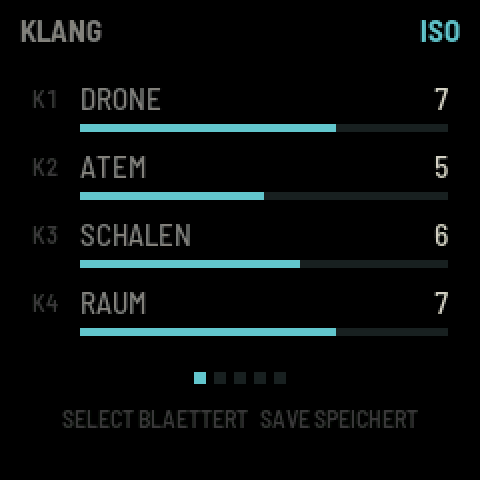 | 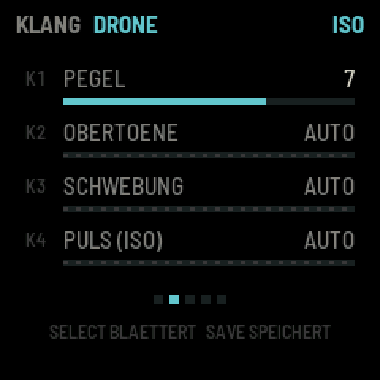 |
| Overview: the four levels | Sub-page DRONE |

| Sub-page | K1 | K2 | K3 | K4 |
|---|---|---|---|---|
| Overview | drone | breath | bowls | space |
| DRONE | level | overtones (AUTO, 0–10) | beating (AUTO, 0–10) | pulse depth in ISO (AUTO, 0–10) |
| BREATH | level | rate (AUTO, 3–8 breaths/min) | colour of the surf (dark – bright) | swell: how much the drone breathes along |
| BOWLS | level | chimes (AUTO, 0 = off – 10 = often) | register (low, middle, high) | ring (short – long) |
| SPACE | reverb amount | reverb size (AUTO, 0–10) | echo amount | – |

### GARDEN (ENV): the musical layer

| | |
|---|---|
| 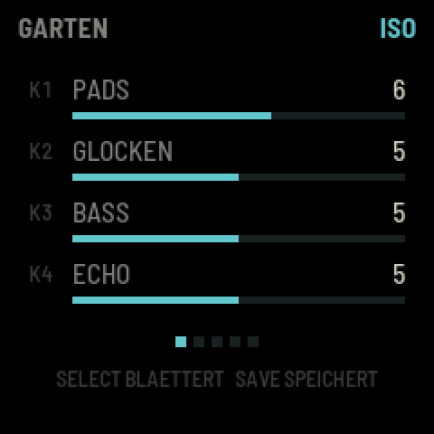 | 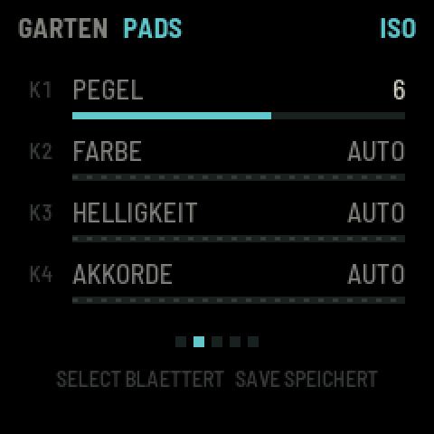 |
| Overview: the four levels | Sub-page PADS |

| Sub-page | K1 | K2 | K3 | K4 |
|---|---|---|---|---|
| Overview | pads | bells | bass | echo |
| PADS | level | colour (AUTO, Rhodes, Voices) | brightness (AUTO, 0–10) | chord changes (AUTO, 0 = rare – 10 = often) |
| BELLS | instrument (bells, handpan, kalimba, tongue, bowls, Koshi) | density (AUTO, 0–10) | tone (AUTO, soft – bright) | octave (AUTO, −2 to +2) |
| BASS | level | octave (AUTO, −1 to +1) | glide (AUTO, 0–10) | fifth (AUTO, 0–10) |
| ECHO | level | echo time (AUTO, 1/4. to 4 bars) | the garden's reverb (AUTO, 0–10) | motion (AUTO, 0–10) |

Instead of the bells, the bell loops can play one of the keys' instruments: handpan, kalimba, tongue drum, singing
bowls or Koshi. Choose it with K1 on the BELLS sub-page; the bells' level is therefore not there but on the overview
(K2). The loops have voices of their own for it and take no notes away from you while you play the keys. The keys'
instrument, scale and ring (SEL) do not apply to the loops: they play the garden's notes, and TONE makes the
instrument brighter or softer.

### INSTRUMENT (SEL): the keys

| | | |
|---|---|---|
| 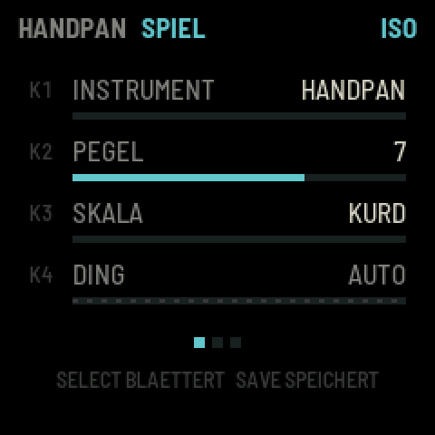 | 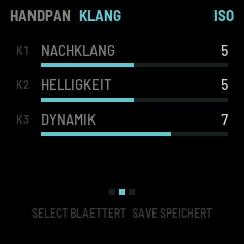 | 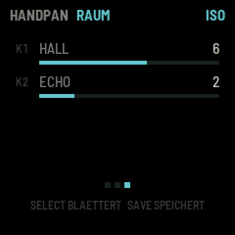 |
| PLAY | TONE | SPACE |

| Sub-page | K1 | K2 | K3 | K4 |
|---|---|---|---|---|
| PLAY | instrument | level | scale | ding (AUTO = follows the carrier, or fixed 174/396/432/528) |
| TONE | ring | brightness | dynamics (0 = every strike alike) | – |
| SPACE | reverb | echo | – | – |

**Scales:** KURD (minor, the classic), CELTIC (minor), INTEGRAL, PYGMY, HIJAZ (oriental), SABYE (major, bright),
AKEBONO (Japanese, very calm). With the ding on AUTO it sits on 174, 198, 216 or 264 Hz, depending on the carrier.

### SETUP (GLO)

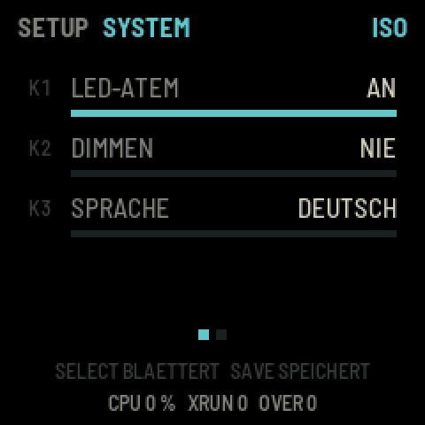

Two sub-pages, SELECT turns between them:

| SYSTEM | |
|---|---|
| **K1 LED breath** | on: a soft light moves right across the long keys as you breathe in, and back as you breathe out |
| **K2 Dim** | the screen dims after 30 s or 2 min without input, or never |
| **K3 Language** | Deutsch, English, Sanskrit |
| **Bottom: CPU, XRUN, OVER** | the load of the sound computation. XRUN counts blocks that finished too late (should stay 0), OVER how often the emergency brake took a voice |

| BEAT | |
|---|---|
| **K1 Tempo** | a silent, steady beat for you as the teacher: OFF or 20–120 a minute |
| **K2 Show on** | SCREEN (a dot at the top of the screen lights on every beat), LFO (the LFO button lights) or BOTH |

<br clear="right">

The beat cannot be heard and is tied neither to the breath nor to the program. It runs at rest too, for counting
breaths or the seconds in a pose, say.

### Saving

**SAVE** keeps all settings: program, duration, ISO/BIN, all levels and fine settings, instrument, SETUP, language
and the silent beat. SAVE is lit while there are unsaved changes. The small keys' mutes are not saved. SAVE also keeps
the sequencer's patterns. They are stored apart from the settings, so resetting the settings leaves them alone.

---

## Language

Under **GLO → K3** you set the screen's language: **Deutsch** (the default), **English** or **Sanskrit**. **SAVE**
keeps the choice.

Sanskrit is shown in Latin transliteration without accents, because the screen knows only Latin letters. Yogic terms
are in Sanskrit, technical ones such as reverb, echo or level in English:

| Deutsch | English | Sanskrit | Meaning |
|---|---|---|---|
| ERDEN | EARTH | PRITHVI | earth |
| LOSLASSEN | RELEASE | VAIRAGYA | detachment |
| HERZ | HEART | ANAHATA | heart chakra |
| WANDLUNG | TRANSFORM | PARINAMA | transformation |
| REISE | JOURNEY | YATRA | journey |
| MANUELL | MANUAL | SVATANTRA | self-determined |
| BEREIT · PAUSE | READY · PAUSE | SAJJA · VIRAMA | ready · pausing |
| ANKOMMEN · VERTIEFEN · RUHEN · AUFWACHEN | ARRIVE · DEEPEN · REST · AWAKEN | AGAMANA · DHYANA · VISHRAMA · PRABODHA | arrival · meditation · rest · awakening |
| KLANG · GARTEN | SOUND · GARDEN | NADA · UDYANA | sound · garden |
| DRONE · ATEM · SCHALEN · RAUM | DRONE · BREATH · BOWLS · SPACE | SHRUTI · PRANA · PATRA · AKASHA | drone · breath · bowl · space/ether |
| GLOCKEN · ECHO · ALLES | BELLS · ECHO · ALL | GHANTA · PRATIDHVANI · SARVA | bell · echo · all |
| STUMM · ENDLOS | MUTE · ENDLESS | MAUNA · ANANTA | silence · endless |

---

## FAQ

**I hear nothing.**
Is MASTER turned up far enough? Is a small key dark, that is, muted? The rightmost key (11) mutes everything. The
volumes of SOUND and GARDEN are shown at the bottom of the home screen (K1, K2).

**With BIN I hear no beating.**
Binaural beats only work with headphones, because each ear must get a tone of its own. Over speakers, use **ISO**.

**It sounds different at every start. Is that right?**
Yes, on purpose. If you want something fixed, turn its value from AUTO to a number and save with SAVE.

**The keys play no sound.**
Check the level on the INSTRUMENT page (SEL). The small keys play no notes; they mute.

**My settings are gone after switching off.**
Press **SAVE** before switching off. SAVE is lit while something is not yet saved.

**My pattern is gone after switching off.**
Patterns are kept only with **SAVE**. After a recording, SAVE is lit until you have saved.

**The screen is so dark.**
It dims after 30 seconds without input. Any key makes it bright again. You can turn that off under SETUP → K2.

**Can I play music from the computer through the FM-1?**
Yes. Over USB the FM-1 appears as an audio device; the music is mixed into the firmware's sound and follows MASTER.
The FM-1's sound can be recorded over USB too.

---

## For developers

### Layout

| Path | Contents |
|---|---|
| `app/dsp/yoga_dsp.c` | the yoga layer and the instruments (float, no libm, no 64-bit multiplies) |
| `app/dsp/amb.c`, `amb.h` | AMB-1's engine (MPL-2.0); changes are marked "yoga:" |
| `app/yoga_program.c` | programs, timing, transitions, randomness, muting, instruments |
| `app/yoga_seq.c` | the sequencer |
| `app/ui.c`, `app/lang.c` | screen, controls, LEDs; the three languages |
| `app/app.c`, `app.h`, `fm1.toml` | the link to fm1-base and the saved settings |
| `app/site/` | the website's front page, in English (`landing.md`) and German (`landing-de.md`) |
| `base/` | [fm1-base](https://github.com/charlesvestal/fm1-base) with felucca-bsp (a Git submodule) |
| `tests/` | sound tests (`yoga_test.c`) and scripts for the host simulator |
| `tools/` | this README's pictures, the website, the emulator server, the Podman shim |
| `docs/img/` | this README's pictures (made by `tools/gen_docs_figures.py`) |
| `fmhub.json`, `firmware.json`, `.github/workflows/release.yml` | the card on The Firmware Hub and the firmware's description; signed releases from the source |

### Requirements (macOS)

- **Podman** (or Docker). The toolchain runs in a linux/amd64 container. `build.sh` passes fm1-base's Docker calls to
  Podman through `tools/podman-bin/docker`. The Podman VM must be running (`podman machine start`).
- the **JieLi Linux toolchain** in `~/.jieli/toolchain`: `base/tools/get_toolchain.sh`
- three files of the **JieLi AC79 SDK** (Apache-2.0) in `~/fw-AC79_AIoT_SDK`. A sparse checkout is enough:

  ```bash
  git clone --depth 1 --filter=blob:none --sparse --branch AC79NN_SDK_V1.2.1_2023-12-13 https://gitee.com/Jieli-Tech/fw-AC79_AIoT_SDK.git ~/fw-AC79_AIoT_SDK
  ```

  ```bash
  git -C ~/fw-AC79_AIoT_SDK sparse-checkout set --no-cone /cpu/wl82/tools/uboot.boot /cpu/wl82/tools/cfg_tool.bin /cpu/wl82/tools/cfg/eq_cfg_hw.bin
  ```

- **Python 3** with Pillow: `pip3 install Pillow`
- for the browser emulator, **Emscripten** (e.g. through [emsdk](https://github.com/emscripten-core/emsdk))

### Build and test

Build the firmware (result: `app/build/yoga.fwsc`):

```bash
./build.sh
```

All tests: sound, programs, transitions, instruments and the whole app in the host simulator, with screenshots and
audio in `app/build/scenarios/`:

```bash
tests/run_tests.sh
```

A program as a WAV to listen to (program, minutes, iso or bin, optionally a seed):

```bash
build/yoga_test wav build/reise.wav reise 10 iso
```

Build the browser emulator:

```bash
source ~/emsdk/emsdk_env.sh && ./build.sh --web
```

Start the emulator (`http://localhost:8792`):

```bash
python3 tools/serve-emu.py
```

Redraw this README's pictures (from the host simulator, after `./build.sh --host`):

```bash
python3 tools/gen_docs_figures.py
```

### Publishing

1. **Release:** a version tag is enough. GitHub then builds the firmware from the source with
   [The Firmware Hub](https://thefirmwarehub.com)'s shared workflow (`.github/workflows/release.yml`), runs the tests,
   signs the package ("Built from source on GitHub") and attaches `yoga-1.0.fwsc` to the release:

   ```bash
   git tag v1.0 && git push origin v1.0
   ```

2. **Website** with web installer, emulator and download, on GitHub Pages (the `gh-pages` branch). It is made from the
   signed package of the release, so the installer offers exactly that file. `tools/site.sh` downloads it, checks it
   against the release's `SHA256SUMS` and writes the site, in English and German, to `app/build/site`:

   ```bash
   tools/site.sh 1.0
   ```

   Then commit the folder's contents to the `gh-pages` branch and push it. In the repository's settings, **Pages**
   must have the `gh-pages` branch as its source.

3. **The Firmware Hub:** the card's description is in `fmhub.json` and `firmware.json` (made by the build from
   `app/fm1.toml`), the picture in `docs/img/hub-240.png`. A release's identity is `FM-1_432` followed by the version
   (1.0: `FM-1_432010000`). Over USB the device reports as the MIDI device "YOGA FM-1".

---

## Licence and thanks

FM1 YOGA is free software under the **Mozilla Public License 2.0** (`LICENSE`).

- The garden's sound engine (pads, bell loops, bass, tape echo, plate reverb) comes from
  [AMB-1](https://github.com/charlesvestal/fm1-amb) by **Charles Vestal** (MPL-2.0). The plate reverb follows
  Jon Dattorro, "Effect Design, Part 1" (JAES 1997).
- The platform [fm1-base](https://github.com/charlesvestal/fm1-base) by Charles Vestal and
  [felucca-bsp](https://github.com/hugelton/felucca-bsp) go back to [Felucca](https://github.com/hugelton/Felucca)
  by **Leo Kuroshita** (Hügelton Instruments) (MPL-2.0).
- Fonts: Barlow (The Barlow Project Authors) and Terminus (Dimitar Toshkov Zhekov), SIL OFL 1.1
  (`base/assets/fonts/`).
- Three files of the JieLi AC79 SDK (Apache-2.0) are read from the SDK at build time and put into the package; they
  are not part of this repository.

"M-VAVE" and "FM-1" are trademarks of their owners and are named here only to say which device FM1 YOGA runs on.
FM1 YOGA is not affiliated with M-VAVE, Hügelton Instruments or the authors of AMB-1, and is neither endorsed nor
checked by them.
