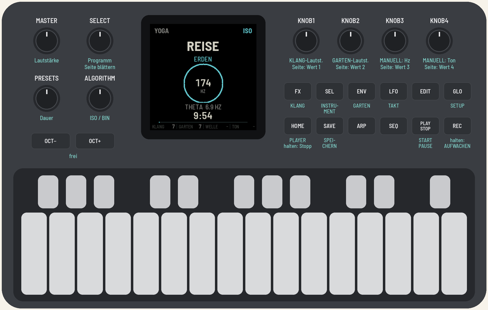

# FM1 YOGA

**English** · [Deutsch](de/)

Sounds for Shavasana and meditation: a firmware for the M-VAVE FM-1. Guided programs on 174, 396, 432 and
528 Hz with a gentle rhythm from theta to delta (ISO for speakers, BIN for headphones), breathing noise, singing
bowls, a floating ambient garden and an instrument on the keys: handpan, kalimba, tongue drum, singing bowls or
Koshi chimes. For Shavasana in a yoga class, or as a calm companion and timer for meditation.

Version {{VERSION}}. Installing is at your own risk; the installer can put M-VAVE's stock firmware back. Relaxation
sounds, not a medical treatment.

- [Try it in the browser](emu/): the same firmware, with sound, no FM-1 needed.
- [Install](install/): in Chrome or Edge, with the FM-1 connected by USB.
- [Download {{PKG}}](firmware/{{PKG}}): for the command line, `python3 base/tools/fm1_install.py {{PKG}}`.
- [Manual](manual/) and [source code](https://github.com/michamilz/fm1-yoga): MPL-2.0. Built on AMB-1 by Charles Vestal and
  fm1-base and felucca-bsp, from Felucca by Leo Kuroshita (Hügelton Instruments).

M-VAVE and FM-1 are trademarks of their owners. FM1 YOGA is not affiliated with M-VAVE.
